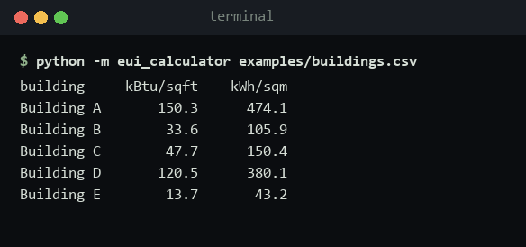

<p align="center"></p>

# eui-calculator

[](https://github.com/yassine2med/eui-calculator/actions/workflows/ci.yml)  

Converts annual energy and floor area in mixed units to EUI in kBtu per square foot and kWh per square metre.



## What it is for

Energy use intensity (EUI) is annual energy divided by floor area, and it is the first number anyone asks for when comparing buildings. An energy manager, facility manager or sustainability analyst gets energy in mixed units (kWh on the electric bill, therms on the gas bill, MMBtu or GJ from a campus report) and area in square feet or square metres. This tool converts everything to kBtu per square foot and kWh per square metre in one step, and rejects bad input instead of guessing.

## Install

```
git clone <this repo>
cd eui-calculator
pip install -r requirements.txt pytest
```

Python 3.10 or newer. No runtime dependencies.

## How to use

| I want to | Command |
| --- | --- |
| Calculate EUI for every building in a CSV | `PYTHONPATH=src python -m eui_calculator examples/buildings.csv` |
| Calculate EUI for one building | `PYTHONPATH=src python -m eui_calculator --energy 5000 --energy-unit therm --area 10000 --area-unit sqft` |
| Use metric area for one building (energy unit defaults to kwh, area unit to sqft) | `PYTHONPATH=src python -m eui_calculator --energy 120000 --area 2500 --area-unit sqm` |
| See all options | `PYTHONPATH=src python -m eui_calculator --help` |

CSV columns: `building,energy,energy_unit,area,area_unit`. Supported energy units: kBtu, MMBtu, therm, kWh, MWh, GJ, MJ. Area units: sqft, sqm. On Windows PowerShell set `$env:PYTHONPATH = "src"` first.

Worked example:

```
PYTHONPATH=src python -m eui_calculator examples/buildings.csv
```

Output:

```
building     kBtu/sqft    kWh/sqm
Building A       150.3      474.1
Building B        33.6      105.9
Building C        47.7      150.4
Building D       120.5      380.1
Building E        13.7       43.2
```

## How it works

1. Each energy value is multiplied by its kBtu factor (for example 1 kWh = 3.412142 kBtu).
2. Each area is converted to square feet (1 sqm = 10.76391 sqft).
3. kBtu/sqft is energy in kBtu divided by square feet.
4. kWh/sqm is the same energy converted back to kWh divided by square metres.
5. Unknown units, negative energy and zero or negative area raise an error that names the CSV line.

## Limits

- Site EUI only. It does not apply source energy factors or weather normalisation.
- One energy figure per row. Sum multiple fuels yourself first, or add one row per fuel.
- The input is assumed to cover one full year.

## License

MIT, see LICENSE. Author: Yassine Emhamed.
